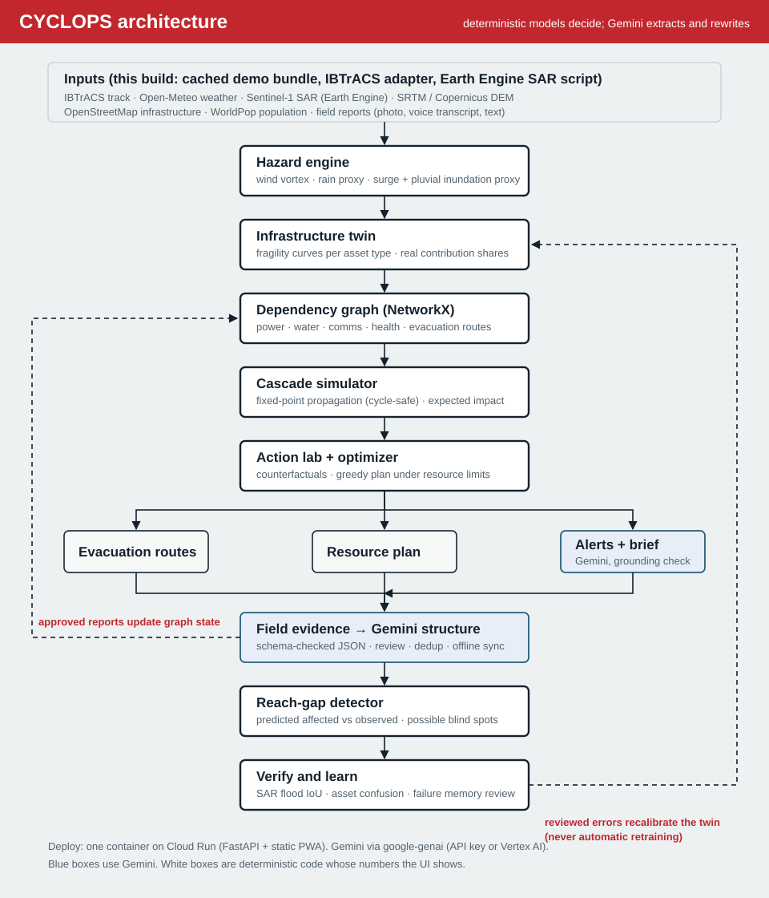

# CYCLOPS: Cyclone Impact & Infrastructure Resilience Twin

**Predict what the cyclone breaks, and what to do before it breaks.**

Track: Cyclone Impact & Infrastructure Vulnerability Forecasting. Build with AI: Code for Communities 2.0.

> **Honesty note.** The demo runs on a deterministic replay scenario. The cyclone track is an approximate replay resembling Cyclone Fani (rounded values, not IBTrACS records). Infrastructure, villages, populations, dependencies, field data and post-event observations are **synthetic** and labelled as such in the UI and API. The hazard model is an explainable proxy, **not** a hydrodynamic storm-surge model. See [Limitations](#13-limitations).

---

## 1. Problem

Cyclone early warning in India has become very good at predicting *where the storm goes* and *how strong it will be*. Odisha's zero-casualty approach, cyclone shelters and mass evacuation are world-class. But district emergency operations centres still have to answer, largely by phone and experience:

- Which substations, towers, bridges and health facilities will fail?
- What else stops working when they fail?
- Which communities lose access to care or a safe shelter route?
- With 2 generators and 3 ambulances, where does each one help most?
- After landfall, who have we *not* heard from, and were our predictions right?

## 2. The operational gap

Existing systems stop at the hazard layer (track, wind, rain, surge zones) or at single-asset risk scores. Real disruption spreads through **dependencies**: a coastal substation fails, its telecom tower runs out of battery, the PHC it feeds loses power and its water pump, and four villages lose health access even though the PHC building itself was barely touched by the storm. Response data then has a second blind spot: communities with dead towers generate *fewer* reports, so the quietest places on the dashboard can be the worst affected.

## 3. Solution

CYCLOPS runs one closed loop: **sense → forecast → impact → cascade → intervene → reach → verify → learn**.

| Question | Feature | Engine |
|---|---|---|
| What is likely to fail? | Impact map + evidence drawer | Hazard proxy + fragility curves |
| What breaks because that asset fails? | Cascade graph with animation | NetworkX dependency graph, probabilistic fixed-point propagation |
| Which communities lose access? | Human impact in every view | Village service model (health + shelter route) |
| What should officials do before landfall? | Action lab + Find best plan | Counterfactual simulation + greedy optimizer under resource limits |
| Who may we be missing? | Reach gap | Predicted-affected vs observed, blind-spot rules |
| What are people seeing? | Multimodal field reports | Gemini → schema-validated JSON → human review → graph |
| Did we get it right? | Verify + failure memory | Flood IoU, asset confusion matrix, Brier, reviewed error log |

**What CYCLOPS is not:** a cyclone tracker, a satellite viewer, a chatbot, an evacuation map or a single risk score. Its difference is the combination: cascade intelligence, counterfactual action, resource optimisation, reach-gap detection, multimodal ground truth, and verification with failure memory.

## 4. 90-second workflow (demo script)

Numbers below are what the current build produces for the **Expected** scenario.

| Time | Screen | Action and line |
|---|---|---|
| 0–10 s | **Command** | *"Most cyclone systems predict where the storm will go. CYCLOPS predicts what the storm may break, and what officials can do before it breaks."* 13 critical assets likely disrupted, 29,592 residents with degraded access (expected value), 3 possible coverage gaps. |
| 10–25 s | **Impact** | Click **P04**: 66% direct disruption risk; evidence drawer shows the real contribution shares (wind 71%, inundation 17%, rain 13%) and the Low/Expected/High range. Click **B17**: near-certain inundation disruption. |
| 25–40 s | **Cascade** | Start from P04, **Show cascade**: P04 → T07, PHC-7, W2 → V10, V12, V14, V16. PHC-7 is only 34% at risk on its own but **82%** once its power and water dependencies are counted. |
| 40–60 s | **Action lab** | **Find best plan** with 2 generators, 3 ambulances, 4 rescue teams, 1 telecom unit: 12 actions, degraded-access residents 29,592 → 17,236, shelter-route loss 21,556 → 7,458, resilience 49 → 65. Each step shows *why* and its marginal benefit. PHC-7 stays above 50% because its water pump also depends on P04; the tool says so instead of hiding it. |
| 60–75 s | **Reach** | Send the sample report *"Electric pole fallen … road blocked"*. Extraction links it to P04. **Approve**: the twin updates (P04 67% → 85%, PHC-7 82% → 89%). |
| 75–90 s | **Reach** | Village K: ~2,100 predicted affected, 42 observed, tower T08 99% disruption risk, last contact 5 h ago → **possible blind spot, dispatch verification team**. Toggle **offline field mode**, file a report, reconnect: it syncs once, deduplicated by report ID. |
| 90–105 s | **Verify** | Before / predicted / observed flood panels; asset outcomes including a highlighted **false positive** on R21 (an elevated road the flood proxy cannot see) stored in failure memory for review. |
| Close | | *"CYCLOPS closes the disaster-response loop: predict, understand cascading impact, choose an intervention, find who may still be missing, and verify what actually happened."* |

Also demoable: scenario switch (Low / Expected / High) updates every screen; **Run compound-failure stress test** (severe scenario + P04, B17, T07 forced down) still produces a plan; **Generate incident brief**; multilingual warnings (English, simple English, Hindi, Odia, voice).

## 5. Architecture



```
frontend/ (no build step: HTML + JS + Leaflet + Cytoscape, PWA service worker)
backend/app/
  data/demo_scenario.py      deterministic bundled scenario (synthetic, labelled)
  engines/hazard.py          wind, rain, surge/inundation proxy on a 0.025° grid
  engines/assets.py          fragility-curve asset risk + contribution shares
  engines/cascade.py         dependency graph, propagation, interventions, impact metrics
  engines/optimizer.py       greedy resource-constrained plan with explanations
  engines/reach.py           reach-gap detector
  engines/verify.py          verification metrics + failure memory
  services/gemini.py         google-genai wrapper: retries, JSON schema, grounding guard
  services/reports.py        extraction, validation, idempotency, dedup, review, overrides
  services/comms.py          grounded alerts + incident brief with template fallback
  services/evaluation.py     labelled evaluation blocks
  adapters/ibtracs.py        real IBTrACS track loader
  main.py                    FastAPI API + serves the frontend
docs/earth_engine_sentinel1_flood.js   Sentinel-1 SAR flood mapping for Fani (Earth Engine)
```

API: `/api/meta`, `/api/cyclones`, `/api/hazard`, `/api/assets`, `/api/simulate`, `/api/interventions/candidates`, `/api/optimize`, `/api/stress-test`, `/api/reach-gap`, `/api/reports` (+ `/{id}/review`), `/api/verify` (+ `/memory/{id}`), `/api/alerts`, `/api/brief`, `/api/evaluation` (+ `/extraction`), `/api/reset`. Interactive docs at `/docs`.

Every prediction response carries `model_versions`, `input_version`, `timestamp` and `scenario_id`.

**Google stack, used only where it earns its place:** Gemini (multimodal extraction, multilingual rewriting, brief), Cloud Run (single container), Earth Engine (Sentinel-1 flood extent script). Firestore/BigQuery are on the roadmap, not bolted on.

## 6. Data sources

| Layer | This build | Production source |
|---|---|---|
| Cyclone track | Approximate Fani replay (rounded) | IBTrACS (adapter included), IMD bulletins |
| Weather | Rain proxy from track | Open-Meteo / IMD gridded rainfall |
| Flood observation | Synthetic, seeded | Sentinel-1 SAR via Earth Engine (script included) |
| Terrain | Synthetic DEM with channels | SRTM / Copernicus DEM |
| Infrastructure | 33 synthetic assets | OpenStreetMap + utility / health department registers |
| Population | 13 synthetic villages, 46,000 residents | WorldPop, Census village directory |
| Field data | Synthetic T+6 h snapshot + live session reports | Control-room logs, shelter check-ins, 112 records |

## 7. Models

**Hazard (per grid cell, `hazard-proxy-0.3`)**
- Wind: modified Rankine vortex along the hourly-interpolated track (Rmax 25 km, decay exponent 0.55, +10% right-of-motion asymmetry). `wind = clip((V − 62) / (260 − 62))`, 62 km/h being gale threshold.
- Rain: accumulated `11·(V/185)·exp(−r/90 km)` mm per hour; `rain = clip(total / 320 mm)`.
- Inundation: coastal surge `1.9 m · (V/185)² · exp(−((s − s0 − 12 km)/35 km)²)` peaking right of landfall, decaying inland `exp(−d/3.5 km)` (slower along channels), minus ground elevation; combined with pluvial ponding in low ground.
- Combined: `0.40·wind + 0.25·rain + 0.35·inundation`. Confidence from the Low/High scenario spread.

**Asset vulnerability (`fragility-logistic-0.2`)**
- Exposure `E = w_wind·wind + w_flood·inundation + w_rain·rain` with type-specific weights (e.g. telecom 0.70/0.20/0.10, bridge 0.05/0.70/0.25).
- Capacity `c = 0.56 − 0.34·vulnerability`; risk `p = 1/(1 + exp(−(E − c)/0.07))`: a fragility-curve form, bounded, not a raw product of percentages.

**Cascade (`cascade-fixedpoint-0.3`)**
- `p_node = 1 − (1 − direct)·Π(1 − p_upstream·strength·(1 − backup))`, iterated to a fixed point so dependency cycles converge.
- Village health loss = PHC failure OR route failure; shelter loss = shelter failure OR route failure OR capacity overflow; degraded access = either. Population figures are expected values.

**Interventions:** generator = 85% backup on the power edge; portable telecom ×0.3 on tower failure; ambulance ×0.55 on health-access loss for its villages; rescue team ×0.6 on shelter loss; reroute switches to a modelled alternative route; shelter activation opens capacity.

**Optimizer (`greedy-marginal-0.2`):** minimises expected degraded-access population + 4000·ΣP(PHC failure) + 1000·ΣP(telecom failure) + 60 per action, subject to resource counts. Greedy, **not guaranteed globally optimal**.

**Gemini:** never sets a risk value. It extracts structured incidents from photos/text (strict `response_schema` + Pydantic validation) and rewrites verified facts into warnings and a brief.

## 8. Explainability

- **Evidence drawer** on every asset: actual contribution shares of the exposure term, capacity threshold, physical proxies (wind km/h, rain mm, surge depth, elevation, distance to coast), Low/Expected/High range, confidence, upstream dependencies with the risk each carries, people served, model and input versions, timestamp.
- **Cascade** shows the exact path and probabilities; node detail lists upstream contributors.
- **Optimizer** explains each step with computed marginal benefit (people, PHC/telecom probability change, dependency).
- No SHAP is claimed because no tree model is used.

## 9. Evaluation

Each block is labelled with its evidence type and they are never mixed (Evaluation page and `/api/evaluation`):

| Block | Result in this build | Evidence type |
|---|---|---|
| Historical validation | **Not run.** Needs past tracks + observed asset-damage labels. | — |
| Flood extent | IoU 0.76, precision 0.94, recall 0.80 | Synthetic stress test (seeded) |
| Asset disruption | 9 hits, 2 false alarms, 2 missed, 19 correct negatives; Brier 0.102; calibration table | Synthetic stress test (seeded) |
| Optimizer | 29,592 → 17,236 degraded-access residents; resilience 49.1 → 64.7 | Simulation comparison (same model) |
| Report extraction | 12 hand-labelled EN/HI/OR reports. Fallback rules: 100% valid output, 92% type accuracy, 50% severity agreement. **The fallback rules were written alongside this set, so this does not measure generalisation.** Run with Gemini configured to evaluate the real extractor. | Tiny labelled test set |

Tests: `pytest` runs 24 tests covering hazard bounds, scenario reproducibility, fragility monotonicity, contribution sums, cascade propagation, cycle handling, intervention rollback, invalid interventions, optimizer resource limits, reach-gap rules, idempotent and near-duplicate reports, invalid Gemini JSON, approved-report graph updates, offline sync replay, the numeric grounding guard, alert route safety, verification metrics, and an end-to-end load → fail → cascade → optimise → apply → brief → stress-test flow.

## 10. Responsible-AI boundaries

Each principle maps to a control in the code (also on the AI and safety page):

- Supports officials, does not replace them: actions are recommendations applied manually; warnings are drafts marked for review.
- Risk is probabilistic: probabilities with Low/Expected/High ranges and confidence everywhere; nothing is labelled certain to fail.
- AI cannot change risk values: hazard, fragility, cascade and optimizer are deterministic code.
- Schema validation: invalid Gemini output is stored as *Invalid AI output, manual review* and never touches the graph.
- Grounding guard: generated warnings/briefs containing any number absent from the structured facts are rejected in favour of the template.
- Warnings never contradict themselves: the alert picks the safest active route, and if none is safe it says so instead of routing people over a failing bridge.
- Citizen reports need verification: pending reports have a discounted effect; only approved ones count as observed damage.
- Missing reports do not prove no impact: reach gap says *possible blind spot* and recommends verification.
- Data minimisation: contact details are not stored (only a flag); maps show community-level markers only.
- No silent learning: mismatches go to failure memory for human review; no automatic retraining.

## 11. Demo

Open the app, stay on the **Expected** scenario, and follow the script in section 4. Use `POST /api/reset` (or restart) to clear session reports before presenting. Without Gemini credentials everything still works: extraction uses transparent keyword rules and warnings/brief use deterministic templates, and the sidebar says so.

## 12. Setup

Requirements: Python 3.11+.

```bash
cd backend
python -m venv .venv && source .venv/bin/activate      # Windows: .venv\Scripts\activate
pip install -r requirements.txt
# optional: enable Gemini. Copy .env.example to .env (project root) and paste your key:
#   GEMINI_API_KEY=your-key
# The app loads .env automatically; real environment variables (e.g. Cloud Run secrets) take priority.
uvicorn app.main:app --reload --port 8000
# open http://localhost:8000
pytest                                                  # 24 tests, offline, deterministic
```

**Background:** a procedural, satellite-style cyclone (`frontend/cyclone-bg.js`) rotates counter-clockwise as Northern Hemisphere storms do and drifts north-west like a Bay of Bengal cyclone approaching Odisha. It intensifies with the High scenario and calms with Low. It is illustrative, not data, pauses when the tab is hidden, drops its frame rate on slow devices, stays still under reduced-motion settings, and has a Pause background button.

The frontend loads Leaflet, Cytoscape and fonts from public CDNs and basemap tiles from CARTO; the coastline, hazard grid and assets are drawn from API data, so the map stays legible if tiles fail.

**Cloud Run**

```bash
gcloud run deploy cyclops --source . --region asia-south1 --allow-unauthenticated \
  --set-secrets GEMINI_API_KEY=gemini-api-key:latest
```

(Store the key in Secret Manager first. For Vertex AI set `GOOGLE_GENAI_USE_VERTEXAI=true`, `GOOGLE_CLOUD_PROJECT`, `GOOGLE_CLOUD_LOCATION` and give the service account the Vertex AI User role.)

**Real flood extent:** paste `docs/earth_engine_sentinel1_flood.js` into the Earth Engine Code Editor to map Fani flooding from Sentinel-1 SAR and export it at the CYCLOPS grid resolution.

## 13. Limitations

- Synthetic infrastructure, population, dependencies, field data and post-event observations. No number in the demo describes a real facility or real damage.
- Hazard is a transparent proxy; it is not ADCIRC/SLOSH-class surge physics and has not been validated against observed Fani flooding.
- Fragility parameters are expert-style assumptions, not fitted to damage data.
- Cascade propagation assumes independence between failures and uses static dependency strengths; restoration times are stored but not yet simulated over time.
- The greedy optimizer is not globally optimal and ignores travel time and deployment logistics.
- Reports and reviews live in memory for the session (restart clears them).
- Hindi and Odia fallback templates need review by native speakers and OSDMA before real use.
- Evaluation numbers are synthetic stress tests or in-model comparisons; historical validation has not been done.

## 14. Production roadmap

1. Replace synthetic layers with OSM + utility and health registers, WorldPop, Copernicus DEM, and the IBTrACS / IMD track feed.
2. Historical validation on Phailin (2013), Hudhud (2014), Fani (2019), Amphan (2020), Yaas (2021): fit fragility curves to outage and damage records; report ROC-AUC, calibration and Brier on held-out cyclones.
3. Couple to a real surge model (e.g. ADCIRC runs or INCOIS storm-surge products) in place of the proxy.
4. Time-stepped cascade with restoration times and battery depletion.
5. MILP / OR-Tools optimisation with travel times and staging constraints.
6. Firestore for reports and review queues, BigQuery for failure memory and calibration datasets, Cloud Storage for photos, automated Sentinel-1 ingestion.
7. IVR / cell-broadcast integration for warnings after OSDMA review, with native-language QA.
8. Field pilots with a district EOC; measure time-to-decision and coverage-gap closure.
